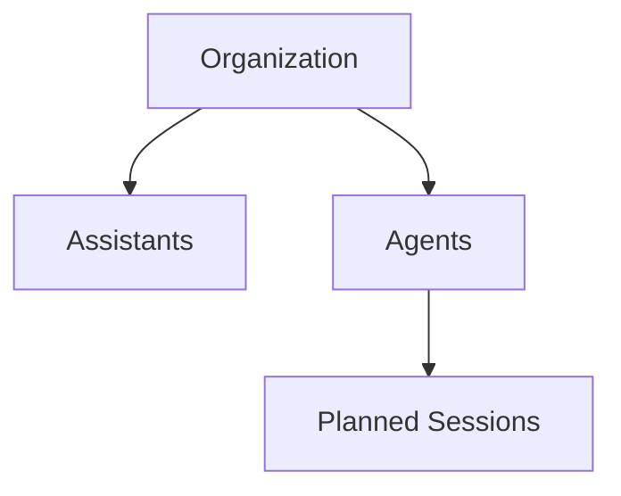

Deepslate Realtime is a platform for building and deploying voice AI at scale. Power inbound call handling with **Assistants** or automate outbound campaigns with **Agents**. Both run on Opal, our end-to-end speech-to-speech model.

The dashboard calls assistants **inbound bots** and agents **outbound bots**. The API uses the names `assistant` and `agent` in its paths, fields, and session types.

## Voice AI Resources

<CardGroup cols={2}>
  <Card title="Assistants" icon="phone-volume">
    **Inbound voice AI** that answers calls to your phone numbers. Configure behavior with system prompts, greetings, and integrations.
  </Card>
  <Card title="Agents" icon="phone-arrow-up-right">
    **Outbound voice AI** that proactively calls customers. Create planned sessions with dynamic data for personalized conversations.
  </Card>
</CardGroup>

## Resource Hierarchy

<AccordionGroup>
  <Accordion title="Assistants" icon="phone-volume">
    Voice AI for handling **inbound calls**. When someone calls your phone number, an assistant answers and handles the conversation.

    **Configuration options:**
    | Setting | Description |
    |---------|-------------|
    | System prompt | Define the assistant's role and behavior |
    | Greeting | Initial message when answering a call |
    | LLM extensions | Add capabilities like knowledge base search |
    | Call event hooks | Trigger webhooks on call events (e.g., transcript ready) |
  </Accordion>

  <Accordion title="Agents" icon="phone-arrow-up-right">
    Voice AI for making **outbound calls**. Agents call customers based on planned sessions.

    **Configuration options:**
    | Setting | Description |
    |---------|-------------|
    | System prompt template | Define the agent's role with dynamic variables |
    | User value types | Define data fields for each call (customer name, order ID, etc.) |
    | LLM extensions | Add capabilities like CRM lookups |
    | Call event hooks | Trigger webhooks on call events |
  </Accordion>

  <Accordion title="Planned Sessions" icon="list-check">
    One outbound call that an agent places. The dashboard shows them under **Planned Calls**. Each planned session contains:

    - **Target number.** The phone number to call.
    - **Parameters.** Key-value pairs that fill the placeholders in the agent's prompt, for example a customer name or a callback reason.
    - **Call window.** Optional time of day, timezone, and weekday limits for dialing.

    Create planned sessions through the [API](/api-reference/sessions-planned/create) for automated campaign workflows. They replace agent tasks, which are deprecated.
  </Accordion>
</AccordionGroup>

## Next Steps

<Card title="API Reference" icon="code" href="/api-reference/introduction">
  Explore the REST API for managing resources programmatically
</Card>
